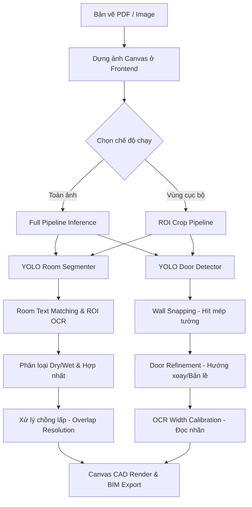

# Quy trình Nhận diện Tự động Sàn (Floor/Room) và Cửa (Door) - EzeFloor AI Engine

Tài liệu này mô tả chi tiết kiến trúc đường ống xử lý (Pipeline), các thuật toán hình học và các bước hậu xử lý thông minh được áp dụng trong hệ thống **EzeFloor** để chuyển đổi hình ảnh bản vẽ 2D (pixel) thành các thực thể CAD/BIM ngữ nghĩa (Semantic CAD Elements) có độ chính xác cao.

---

## Tổng quan Kiến trúc AI Pipelines

Hệ thống kết hợp mô hình học sâu **YOLO (v8/v11)** để phân đoạn hình học (Segmentation) & phát hiện vật thể (Detection), kết hợp với thư viện xử lý ảnh **OpenCV** và thư viện phân tích cấu trúc hình học **Shapely** để hoàn thiện dữ liệu CAD.

---

## 1. Quy trình Nhận dạng Sàn/Phòng (Floor/Room Detection)

Đường ống nhận diện phòng chuyển đổi các pixel ảnh thô thành các đa giác khép kín (`polygon`) có tên nhãn thực tế, diện tích tính bằng mét vuông và phân loại chất liệu sàn.

### Bước 1.1: Phân đoạn hình học bằng YOLOv8-seg / YOLO11-seg
* **Đầu vào**: Ảnh thô hoặc ảnh crop ROI được co giãn tương thích về `imgsz=1280` để đạt sự cân bằng tối ưu giữa tốc độ suy luận và khả năng phát hiện các phòng nhỏ.
* **Đầu ra**: Tập hợp các đa giác phân đoạn biểu diễn các vùng phòng riêng lẻ trên bản vẽ.
* **Làm mịn đa giác (Polygon Smoothing)**: Các đa giác thô xuất ra từ YOLO thường có răng cưa. Hệ thống áp dụng bộ lọc Douglas-Peucker (đơn giản hóa đa giác) tỉ lệ thuận với kích thước bản vẽ, kết hợp thuật toán **Orthogonal Snapping** (hút các cạnh nghiêng dưới 7° thành góc thẳng đứng $90^\circ$ hoặc nằm ngang $0^\circ$), mang lại các góc tường phẳng phiu chuẩn CAD.

### Bước 1.2: So khớp nhãn tên phòng (YOLO + OCR Text Matching)
Hệ thống sử dụng cơ chế so khớp ngữ nghĩa 2 lớp:
1. **Quét toàn ảnh**: Phát hiện vị trí các nhãn chữ bằng YOLOv8-Text, trích xuất chuỗi ký tự bằng `PaddleOCR`/`EasyOCR`.
2. **So khớp Centroid (Shapely)**: Xác định centroid (tâm trọng lực) của từng nhãn chữ. Bằng thư viện `Shapely`, hệ thống kiểm tra nhãn chữ nào rơi vào bên trong đa giác phòng nào:
   $$\text{Centroid}(T) \in \text{Polygon}(R)$$
3. **Fuzzy Text Matching & Mappings**: Nhãn thô sẽ được làm sạch ký tự rác (Junk texts như vật liệu, cao độ, mã cửa) và chuẩn hóa thông qua bộ nhớ đệm OCR (OCR Memory) cùng cơ chế so khớp mờ Rapidfuzz (ví dụ: `HALLVAY` $\rightarrow$ `HALLWAY`, `VVIR` $\rightarrow$ `WIR`).
4. **Cropped OCR cho phòng khuyết nhãn**: Với các phòng AI chưa tìm thấy nhãn chữ bằng quét tổng thể, hệ thống tự động crop riêng lẻ từng đa giác phòng đó, xoay các góc nghiêng $90^\circ, 180^\circ, 270^\circ$ và chạy OCR cục bộ để săn tìm nhãn chữ bị sót.

### Bước 1.3: Phân loại chất liệu Semantics (Dry / Wet / Outdoor)
Phòng sau khi được gán nhãn sẽ được phân lớp vùng chức năng:
* **Wet Room (Phòng Ướt)**: Gồm `BATH`, `WC`, `ENSUITE`, `LAUNDRY`, v.v. Các phòng này được hiển thị viền đỏ nhạt, tự động tính định mức lát sàn gạch chống thấm nước trong BOQ.
* **Dry Room (Phòng Khô)**: Gồm `BEDROOM`, `LIVING`, `KITCHEN`, v.v. Viền xanh dương mỏng nhẹ, tính định mức sàn gỗ/thảm.
* **Outdoor (Không gian ngoài trời)**: Các vùng `DECK`, `BALCONY`, `ALFRESCO` tính định mức sàn gỗ ngoài trời.

### Bước 1.4: Hậu xử lý & Hoàn thiện đa giác phòng
1. **Không hợp nhất các phòng nhãn chung (Generic Rooms)**: Hệ thống ngăn chặn việc tự động hợp nhất các phòng có tên nhãn chung (`ROOM`, `UNKNOWN`, `VOID`, `SPACE`, `AREA`) ở gần nhau để bảo toàn độc lập biên dạng phòng qua vách ngăn mỏng. Các phòng có tên cụ thể (như `BED 1` bị chia tách do nét vẽ cắt ngang) sẽ được union thành 1 phòng duy nhất nếu khoảng cách dưới 15px.
2. **Triệt tiêu chồng lấp (Overlap Resolution)**:
   Sắp xếp các đa giác theo thứ tự ưu tiên: phòng ướt trước, phòng khô sau; phòng nhỏ trước, phòng lớn sau. Tiến hành trừ tập hợp hình học (Shapely `.difference`) các đa giác xử lý sau bởi các đa giác nằm trước:
   $$R_{\text{clipped}} = R_i \setminus \bigcup_{j < i} R_j$$
   Điều này đảm bảo không có hai phòng nào bị chồng lấp lên nhau, diện tích tính toán m2 đạt độ chuẩn xác tuyệt đối.

---

## 2. Quy trình Nhận dạng Cửa (Door Detection & Alignment)

Quy trình nhận diện cửa phát hiện các cánh cửa (Single, Double, Sliding), tự động xoay và gắn mép chính xác vào các khe tường dọc (Vertical) hoặc ngang (Horizontal).

### Bước 2.1: Nhận diện Khung bao thô bằng YOLOv8
* Mô hình YOLO Door phát hiện các bounding boxes quanh khu vực cửa, phân lớp thành `single` (cửa đơn), `double` (cửa đôi), hoặc `sliding` (cửa lùa) dựa theo xác suất tin cậy.

### Bước 2.2: Thuật toán Snapping Mép tường Đỉnh cao (Wall-Edge Peak Detection)
Cửa nhận diện thô từ YOLO thường bao gồm cả đường cong nét đứt mở cửa, dẫn đến tâm của bounding box bị lệch hẳn ra ngoài bức tường. EzeFloor giải quyết điều này bằng thuật toán phân tích điểm ảnh xám OpenCV:
1. Xác định hướng phân đoạn tường: Nếu $W_{\text{bbox}} > H_{\text{bbox}}$, tường nằm ngang; ngược lại, tường nằm dọc.
2. Quét dải pixel nằm gần 2 biên cạnh của bbox (biên trên/dưới đối với tường ngang; biên trái/phải đối với tường dọc) bằng hàm OpenCV Canny Edge.
3. Tính toán số lượng điểm ảnh tối cực đại (Peak Dark Pixels) dọc theo hai biên. Biên nào có mật độ điểm ảnh biên cao nhất chính là trục xương của bức tường thật.
4. Tự động dịch chuyển (snap) 2 điểm tọa độ đầu cuối $p_1, p_2$ của cánh cửa bám khít dọc theo trục xương tường này.

### Bước 2.3: Tinh chỉnh hình học Door Refinement (Hinge & Swing Direction)
Hệ thống sử dụng bộ lọc OpenCV HoughLinesP để dò tìm chính xác góc nghiêng vật lý của cánh cửa mở thực tế trong bản vẽ và so khớp:
* **Hinge Point (Bản lề)**: Xác định điểm xoay nằm ở đầu $p_1$ hay $p_2$.
* **Swing Direction**: Hướng mở cửa xoay theo chiều kim đồng hồ (`clockwise`) hay ngược chiều kim đồng hồ (`counterclockwise`).
* **Hinge Side & Swing**: Ánh xạ góc xoay về tham số CAD tiêu chuẩn hiển thị trên Canvas (`hingeSide: left/right`, `swing: inward/outward`) để vẽ chính xác cung tròn mở cửa (Arc sweep).

### Bước 2.4: Đọc Kích thước cửa bằng OCR cục bộ
* Một cửa sổ ROI có đệm nhỏ (padding 45px) được trích xuất xung quanh tọa độ cửa.
* Hệ thống chạy OCR đọc các ký số nằm trong dải kích thước cửa chuẩn (như `720`, `820`, `870`, `920`). Nếu tìm thấy nhãn chữ hợp lệ, chiều rộng thực tế tính bằng milimét của cửa sẽ được thiết lập theo nhãn sản xuất này thay vì đo kích thước pixel thô.

---

## 3. Quy trình Suy luận Cục bộ ROI (Region of Interest)

Khi người dùng khoanh vùng chọn ROI để tái nhận dạng một khu vực nhỏ:

1. **Thu thập tham số**: Frontend gửi tọa độ ROI (`roi_x, roi_y, roi_w, roi_h`) kèm đệm padding đặc thù cho từng mô hình (Tường: 96px, Cửa: 160px, Phòng: 256px) để tránh hiện tượng mất ngữ cảnh đường biên.
2. **Inference**: Ảnh cắt (crop) từ ảnh gốc được gửi lên backend, thực hiện suy luận YOLO độc lập và ánh xạ ngược hệ tọa độ (Coordinate Remapping) của các vật thể phát hiện được về hệ tọa độ bản vẽ gốc:
   $$X_{\text{global}} = X_{\text{crop}} + X_{\text{offset}}$$
3. **Bảo vệ biên (Clipping Protection)**: Vật thể nào chạm vào biên cứng của vùng ROI sẽ được gán cờ `partial_object: true` để tránh đưa vào các kết quả không trọn vẹn.
4. **Hòa trộn Kết quả (Additive Blending)**:
   Ở chế độ `Additive Mode`, các phòng mới phát hiện từ ROI sẽ được so khớp chỉ số IoU bounding box (`_bboxIoU`) với các phòng hiện có.
   * Ngưỡng **`IOU_THRESHOLD = 0.15`** được tinh chỉnh thấp để đảm bảo các phòng có xu hướng trùng lặp sẽ ngay lập tức được **thay thế bằng phiên bản mới có độ phân giải cao hơn** từ ROI thay vì chèn đè lên nhau gây lỗi nhân đôi đa giác trên CAD Canvas.
