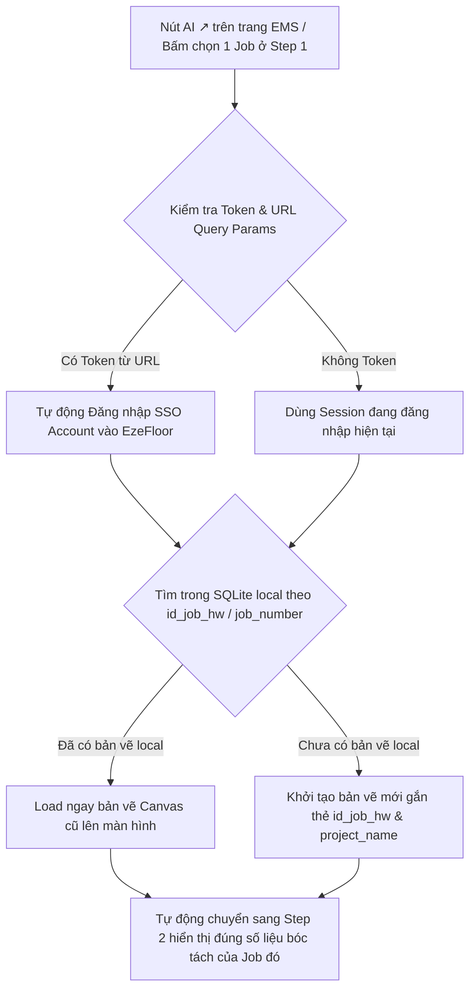

# Plan Kiến trúc: Tự động kết nối HW Job ID (`task_group_hw.id`) với SQLite Canvas, Modals Bóc tách & Deep Link Nút `AI ↗`

## 1. Tổng quan Kiến trúc (Core Architecture Concept)

Thay vì quản lý bản vẽ Canvas và dữ liệu Bóc tách tách rời nhau, hệ thống sẽ sử dụng mã **`task_group_hw.id` (`IdJob_HW`)** từ MSSQL làm **Khóa chính liên kết duy nhất (Master Foreign Key)** kết nối cả 3 tầng dữ liệu:

1. **Tầng Master HW Job (MSSQL)**: Bảng `[emsflow].[dbo].[task_group_hw]` cung cấp `id` (HW Job ID) và `id_job_ems` liên kết với `ListJobs.JobNumber` (ví dụ `EZEFLO-77-6335409` hoặc `TestAI`).
2. **Tầng Bản vẽ Canvas (SQLite Local)**: Bảng `jobs` chứa `id_job_hw`, `project_name`, `data` (chuỗi JSON lưu toàn bộ trạng thái vẽ phòng, tường, cửa, tỷ lệ vẽ).
3. **Tầng Bóc tách Khối lượng (MSSQL)**: Các bảng `Insulation`, `AreaSummary`, `Framework` chứa dữ liệu bóc tách được gắn liền với `IdJob_HW`.

---

## 2. Quy trình Hoạt động Tự động (Automated Workflow)



---

## 3. Các bước Triển khai Kỹ thuật (Technical Implementation Steps)

### Bước 1: Bổ sung trường `id_job_hw` vào CSDL Local SQLite (`jobs`)
- **`backend/app/database.py`**:
  Thêm cột `id_job_hw INTEGER` vào bảng `jobs` trong SQLite để ghi nhớ ID của bảng `task_group_hw`.
  ```sql
  ALTER TABLE jobs ADD COLUMN id_job_hw INTEGER;
  CREATE INDEX IF NOT EXISTS idx_jobs_hw_id ON jobs (id_job_hw);
  ```

### Bước 2: Bổ sung API tìm kiếm bản vẽ theo `id_job_hw` & Xác thực Token SSO
- **`backend/api/jobs.py` & `backend/api/auth.py`**:
  1. Cập nhật API `POST /api/jobs` nhận thêm tham số `id_job_hw`.
  2. Tạo mới API `GET /api/jobs/by-hw/{id_job_hw}`:
     - Cho phép lấy nhanh toàn bộ dữ liệu vẽ Canvas dựa trên `id_job_hw` hoặc `project_name`.
  3. API `GET /api/auth/sso-login?token=...`:
     - Tự động tạo Session và đăng nhập cho User dựa trên Token an toàn truyền từ web quản lý EMS.

### Bước 3: Cập nhật Controller nạp dự án ở Frontend
- **`frontend_next/src/controllers/project.controller.js`**:
  - Thêm hàm `handleLoadJobByHwId(id_job_hw, project_name)`:
    Gọi API `/api/jobs/by-hw/{id_job_hw}`. Nếu tìm thấy bản vẽ Canvas đã lưu trước đó, tự động đổ dữ liệu (`pages`, `roomsByPage`, `wallsByPage`, `doorsByPage`, `scalesByPage`) lên màn hình làm việc.

### Bước 4: Liên kết sự kiện Click chọn Job ở Step 1 Modals
- **`InsulationJobsModal.jsx`**, **`FrameworkJobsModal.jsx`**, **`AreaSummaryJobsModal.jsx`**:
  Khi người dùng click chọn 1 Job ở Step 1:
  ```javascript
  const handleSelectJob = async (job) => {
    const hwId = job.hw_id || job.IdJob_HW;
    const jobNum = job.job_number;
    
    // 1. Tự động tải bản vẽ Canvas tương ứng nếu có
    await handleLoadJobByHwId(hwId, jobNum);
    
    // 2. Chuyển sang Step 2 bóc tách của Job này
    setSelectedJobNumber(jobNum);
    setCurrentStep(2);
  };
  ```

---

## 4. Tích hợp Nút `AI ↗` Deep Link & Tự động Đăng nhập (Single Sign-On & Auto-Load)

### Ý tưởng & Luồng xử lý (SSO Deep-Link Flow)

Khi người dùng ở trang quản lý EMS bấm vào nút **`AI ↗`** cạnh mã Job (ví dụ `TestAI`):

1. **Cấu trúc Đường link Nút `AI ↗`**:
   Nút **`AI ↗`** trên trang EMS sẽ mở liên kết sang ứng dụng EzeFloor chứa các tham số trên URL:
   ```text
   https://ezefloor.app/?job_number=TestAI&job_id=1234&token=EXPIRE_SESSION_TOKEN
   ```

2. **Xử lý Tự động Đăng nhập (Auto Authentication)**:
   - Khi EzeFloor khởi chạy, component chính (`App.jsx`) đọc tham số `token` từ URL (`window.location.search`).
   - Tự động kích hoạt đăng nhập tài khoản người dùng tương ứng vào EzeFloor mà **không bắt người dùng phải gõ username/password lại**.

3. **Xử lý Tự động Mở đúng Job (Auto-Load Target Job)**:
   - Đọc tham số `job_number` (`TestAI`) hoặc `job_id` (`1234`).
   - Tự động gọi `handleLoadJobByHwId(1234, 'TestAI')` để tải bản vẽ Canvas của Job `TestAI` lên màn hình làm việc.
   - Khi bấm các nút bóc tách (`AreaSummary`, `Framework`, `Insulation`), ứng dụng đã nằm sẵn ở Step 2 hiển thị đúng số liệu của `TestAI`.

---

## 5. Kế hoạch Kiểm thử & Xác minh (Verification Plan)

### Kiểm thử Quy trình:
1. Giả lập bấm nút **`AI ↗`** với URL: `?job_number=TestAI&token=xyz`.
2. Hệ thống EzeFloor tự động xác thực đăng nhập tài khoản.
3. Màn hình Canvas tự động nạp bản vẽ `TestAI`.
4. Mở các Modal bóc tách -> Tự động ở Step 2 hiển thị đúng dữ liệu bóc tách của `TestAI`.
